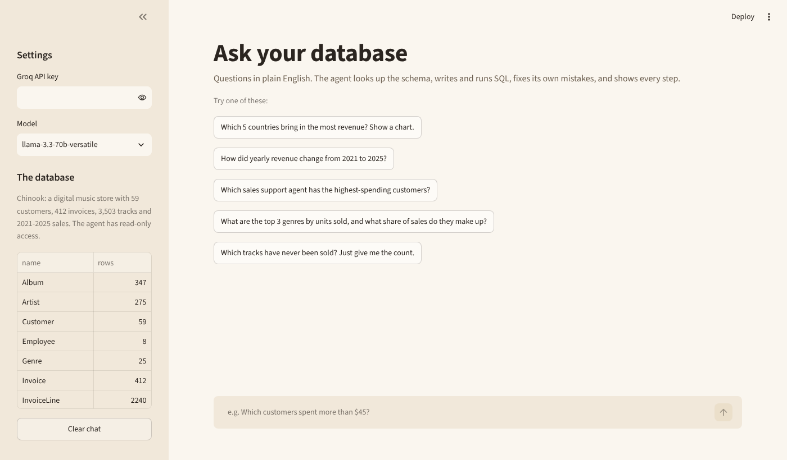

# SQL Analyst Agent

An LLM agent that answers business questions about a database in plain English. It inspects the schema, writes and runs SQL, recovers from its own errors, does arithmetic with a calculator tool, draws charts, and shows every step it took. It's built on Groq tool calling (GPT-OSS 120B) with a **hand-written agent loop**, no agent framework.



## Example questions

- *Which 5 countries bring in the most revenue? Show a chart.*
- *How did yearly revenue change from 2021 to 2025?*
- *Which sales support agent has the highest-spending customers?*
- *What are the top 3 genres by units sold, and what share of sales do they make up?*

For each answer, the "How I got this" panel shows every tool call: the SQL it ran, the result table, any errors it hit, and the calculations it made.

## How the agent works

```
question ──► LLM (with tool schemas) ──► tool call? ── no ──► final answer
                  ▲                          │ yes
                  │                          ▼
                  └──── tool result ◄── run tool (read-only)
                          (repeat up to 10 steps)
```

**Tools**

| Tool | What it does |
|---|---|
| `list_tables` | table names with row counts |
| `describe_table` | columns, types, foreign keys and 3 sample rows |
| `run_sql` | runs one read-only SELECT; returns up to 50 rows to the model and keeps up to 200 for charts |
| `calculator` | safe arithmetic (an AST evaluator, not `eval`) for percentages and growth rates |
| `make_chart` | bar / line / pie chart from the last query result, rendered with Plotly |

**Why a hand-written loop?** The whole agent is about 80 lines in `agent/core.py`. Writing it directly makes the moving parts easy to see and test: the message history, tool-call parsing, feeding results back, error handling and the step limit.

## Safety

The model never gets write access, enforced in two independent layers:

1. **Query checks:**
   - only one statement per call
   - the query must start with `SELECT` or `WITH`
   - keywords such as `DELETE`, `DROP`, `UPDATE`, `ATTACH` and `PRAGMA` are rejected
2. **A read-only connection:** SQLite is opened with `mode=ro`, so even a query that slipped past the checks couldn't change anything. A test confirms this.

Tool errors (bad SQL, unknown tables, invalid arguments) are returned to the model as messages instead of crashing the app, so it can correct itself. A step limit stops runaway loops.

## Evaluation

`eval/questions.json` has 12 questions whose correct answers I computed with hand-written SQL. They include:
- multi-table joins (revenue per sales agent)
- date logic (revenue in a given year)
- anti-joins (tracks never sold)
- arithmetic (percentage change between years)

```bash
python -m eval.run_eval      # needs GROQ_API_KEY
```

The script checks that every expected name and number appears in the agent's final answer, then writes a results table with the number of tool calls and the time taken per question to `eval/results.md`.

## Tests

```bash
pytest -q     # 18 tests, no API key needed
```

The agent loop is tested with a scripted fake LLM client, so the tests cover:
- the tool-call cycle, and results being fed back to the model
- recovery after a failed SQL query
- the step limit

There are also tests for every tool, all the write-blocking rules, the read-only connection, calculator safety and the eval answer matcher.

## Run it

```bash
git clone https://github.com/Fasiuu/sql-analyst-agent
cd sql-analyst-agent
pip install -r requirements.txt
cp .env.example .env     # add a free Groq key from console.groq.com
streamlit run app.py
```

## The data

[Chinook](https://github.com/lerocha/chinook-database) is a sample database of a digital music store: 59 customers, 412 invoices, 2,240 invoice lines, 3,503 tracks, 347 albums, 275 artists and 8 employees, with sales from 2021-2025. It's included in `data/`.

## Project structure

```
app.py             Streamlit chat UI with step-by-step trace and charts
agent/core.py      the agent loop and system prompt
agent/tools.py     tools, JSON schemas, SQL safety checks, safe calculator
eval/              12 questions with verified answers + evaluation script
tests/             pytest suite with a fake LLM client
```
